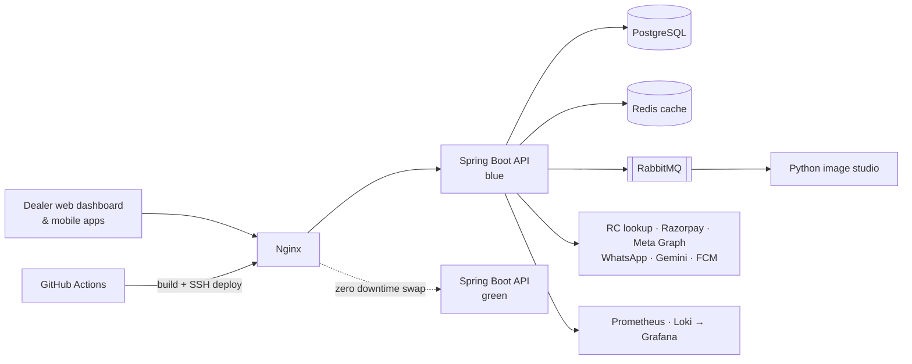

# Vahn360

**Used-car dealership SaaS: inventory, leads, insurance, credits, publishing and dealer websites in one backend.**

         

> [!NOTE]
> **Showcase repository.** This is client work built at Runtime Solutions, and its source code is private. This page documents the product, my role and the engineering behind it.

## Overview

Vahn360 runs the day-to-day of a used-car dealership: sourcing and onboarding vehicles from a registration number, managing inventory and leads, tracking insurance renewals, publishing stock to Facebook, Instagram and WhatsApp catalogs, billing dealers through a credit wallet, and giving each dealership its own public website. A web dashboard and mobile apps sit on top of a single Spring Boot backend.

## My role

**Primary backend engineer**: about 1,275 of the repository's 1,620 commits. I designed and built most modules end-to-end, from schema and Flyway migrations (147 so far) through services, APIs, integrations, deployment and monitoring.

## Tech stack

| Layer | Technologies |
|---|---|
| Backend | Java 21, Spring Boot 3.5, Spring Security (JWT + refresh-token rotation), Spring Data JPA, WebSockets |
| Data | PostgreSQL, Flyway, Redis (reference-data caching) |
| Async & media | RabbitMQ, Python image service (BiRefNet via rembg) |
| Integrations | Vahan / Surepass / Nivora RC lookup, Razorpay autopay, Meta Graph API, WhatsApp Cloud API, Google Gemini, Firebase FCM |
| Infra | Microsoft Azure, GitHub Actions, Nginx, systemd, Prometheus, Grafana, Loki |

## Architecture

## What I built

- **Vehicle onboarding by registration number**: a multi-provider RC bridge (Nivora → Surepass → cache) with per-document TTL rules; challans load asynchronously so RC details return immediately.
- **Lead management**: lead flows, follow-up scheduling with timer notifications, matched-vehicle ranking with strict transmission/fuel rules, CSV/Excel exports and a sales funnel with drill-downs.
- **Credit-wallet billing**: rate cards, repeat-search rules, refunds and a credit ledger, plus Razorpay autopay with queued plans, expiry schedulers and payment-link emails when a mandate fails.
- **Publishing**: pushes vehicles to Facebook/Instagram catalogs with multi-photo and carousel posts, and runs a WhatsApp catalogue with interactive templates and click tracking.
- **AI features**: Gemini lead-to-vehicle matching with automatic model discovery and 429/quota fallback rotation, licence-plate masking, and a Python studio that composites cars onto clean backgrounds.
- **Dealer website builder**: templates, validated section layouts, custom domains and a leads API for each dealership's public site.
- **Insurance tracking**: renewal reminders over WhatsApp and email, provider normalization and upcoming-expiry filters.

## Engineering highlights

- **Zero-downtime blue/green deploys**: GitHub Actions builds the JAR and deploys over SSH; systemd-instantiated services swap behind Nginx after actuator health checks, then Redis is reset. I fixed OOM kills during the overlap window by tuning JVM heap and provisioning swap.
- **Observability from scratch**: Grafana dashboards for SLA availability, latency percentiles, security events and a real-time faulty-API anomaly detector, fed by Prometheus and Loki.
- **Tamper-evident auditing**: a Postgres engine-level audit that also captures direct psql and script changes, alongside an `@Auditable` application-level audit.
- **Device-bound sessions**: refresh-token rotation and per-company concurrent-login control keyed on device ID.
- **Fast search**: typo-tolerant suggestions with parallel lookups over an in-memory catalog cache, returning deep-link IDs for mobile navigation.

---

**Priyansu Chowdhury**: Backend-leaning full-stack developer (Java / Spring Boot · Next.js / TypeScript)

[LinkedIn](https://linkedin.com/in/priyansu-chowdhury) · [GitHub](https://github.com/Pr1yansu)

